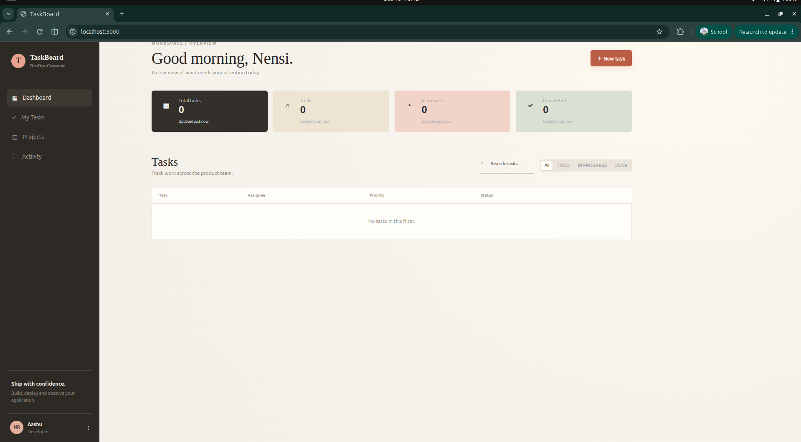
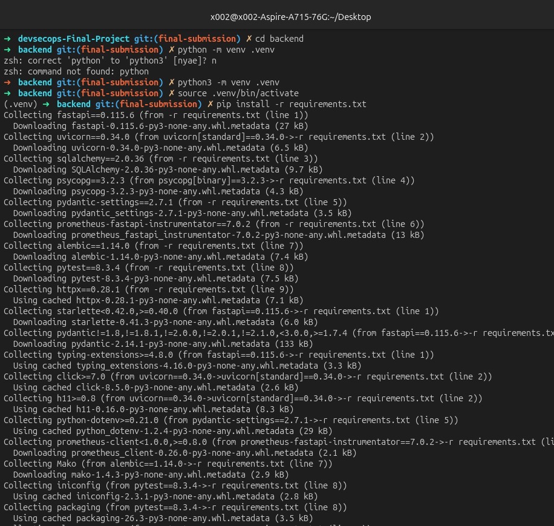
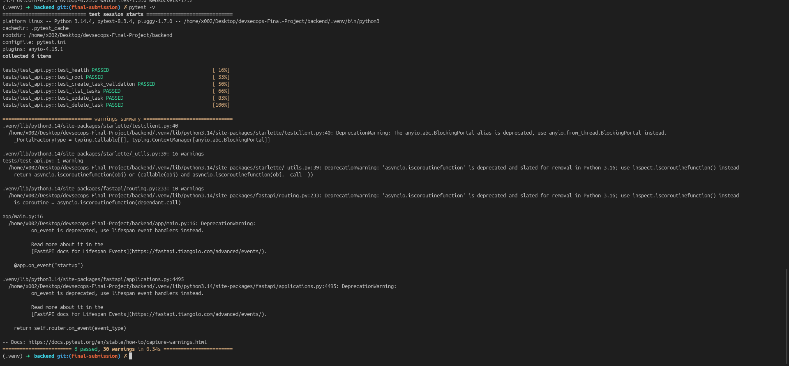

# Local Development

## Application topology

Docker Compose runs three services:

| Service | Container port | Host access | Purpose |
|---|---:|---:|---|
| `frontend` | 80 | 3000 | React application served by Nginx |
| `backend` | 8000 | 8000 | FastAPI API and metrics endpoint |
| `postgres` | 5432 | 5433 | Persistent application database |

The backend waits for PostgreSQL's health check before starting. The host port is `5433` so a local PostgreSQL installation on `5432` does not conflict with the stack.

## Start the complete stack

```bash
docker compose up --build
```

Open the application at `http://localhost:3000`. Useful backend endpoints are:

```text
GET /health       liveness response
GET /ready        database readiness response
GET /docs         interactive OpenAPI documentation
GET /metrics      Prometheus-formatted application metrics
```

Stop the services with `docker compose down`. Add `-v` when the local PostgreSQL volume should also be removed.



## Backend tests

The test suite uses an isolated SQLite database rather than the Compose PostgreSQL database:

```bash
cd backend
python3 -m venv .venv
source .venv/bin/activate
pip install -r requirements.txt
pytest -v
```





## Frontend build

The frontend uses a Node build stage and an Nginx runtime stage:

```bash
cd frontend
npm ci
npm run build
```

The Nginx configuration proxies `/api` requests to the backend service when the image is deployed.