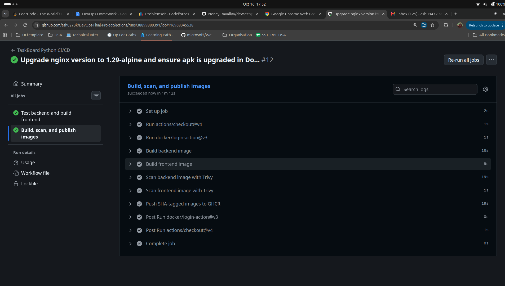
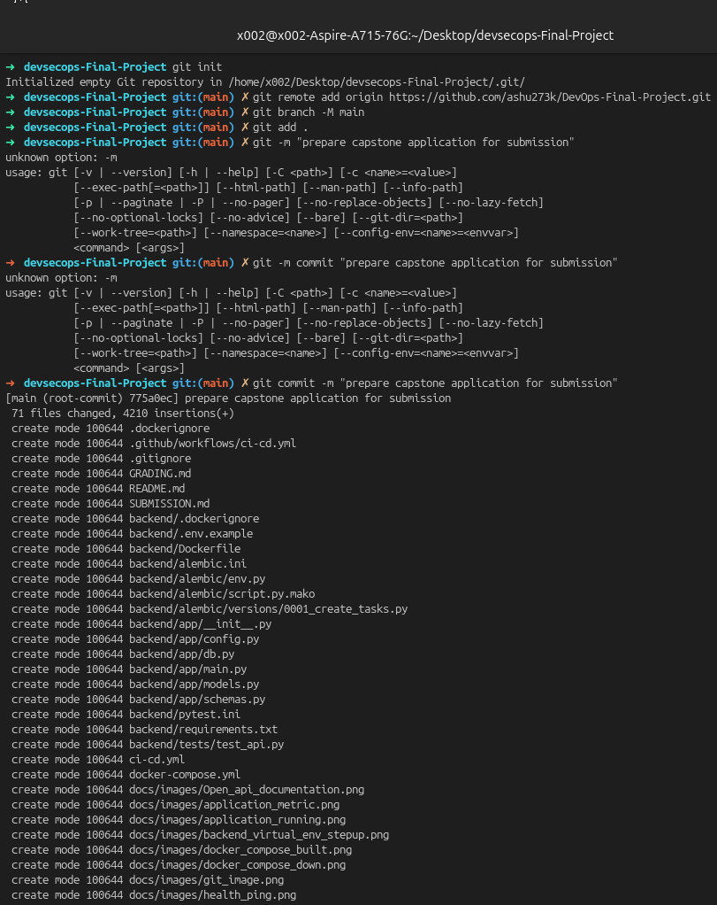
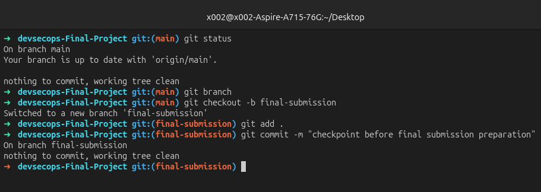

# CI/CD and Supply-Chain Security

The workflow is defined in [`.github/workflows/ci-cd.yml`](../.github/workflows/ci-cd.yml). It has two stages with an explicit dependency: images are built only after tests and the frontend build succeed.

## Pipeline behavior

| Event | `test` job | `build-scan-push` job |
|---|---|---|
| Pull request | Backend tests and frontend build | Not run |
| Push to `main` | Backend tests and frontend build | Build, scan, and publish images |

The publishing job uses `GITHUB_SHA` as the image tag:

```text
ghcr.io/<owner>/taskboard-backend:<commit-sha>
ghcr.io/<owner>/taskboard-frontend:<commit-sha>
```

This makes every deployed image traceable to an exact source revision and avoids relying on a mutable `latest` tag.

## Security gate

Trivy scans both locally built images. The command is configured with:

- `HIGH,CRITICAL` severity only
- `--ignore-unfixed` to exclude vulnerabilities without an available fix
- `--exit-code 1` so a qualifying finding fails the job

The images are pushed to GHCR only after both scans pass. The workflow grants `packages: write` only to the publishing job; no cloud credentials are required by the pipeline.







## Local validation before pushing

```bash
cd backend && pytest -v
cd ../frontend && npm ci && npm run build
```

For a `main` deployment, record the commit SHA from the workflow run and pass it to Helm as the backend and frontend image tag. The current repository publishes images but does not automatically deploy them to Kubernetes.