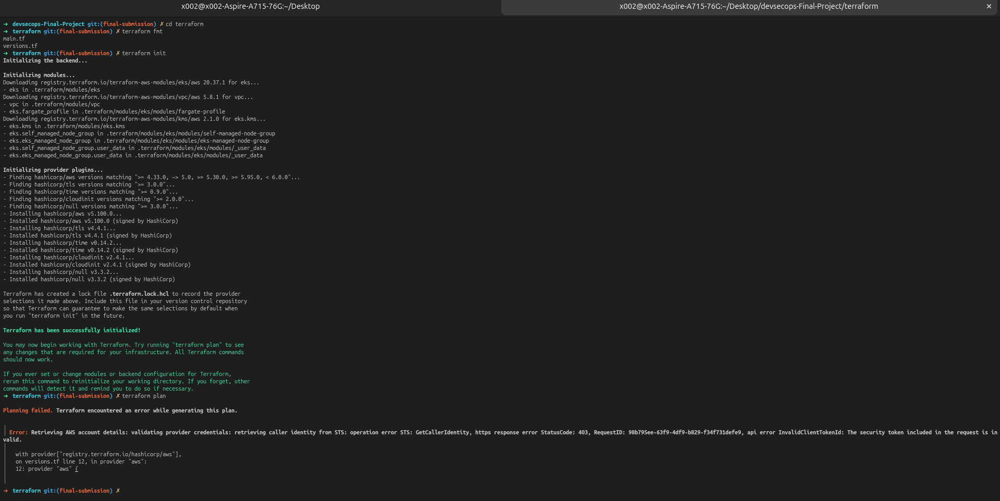
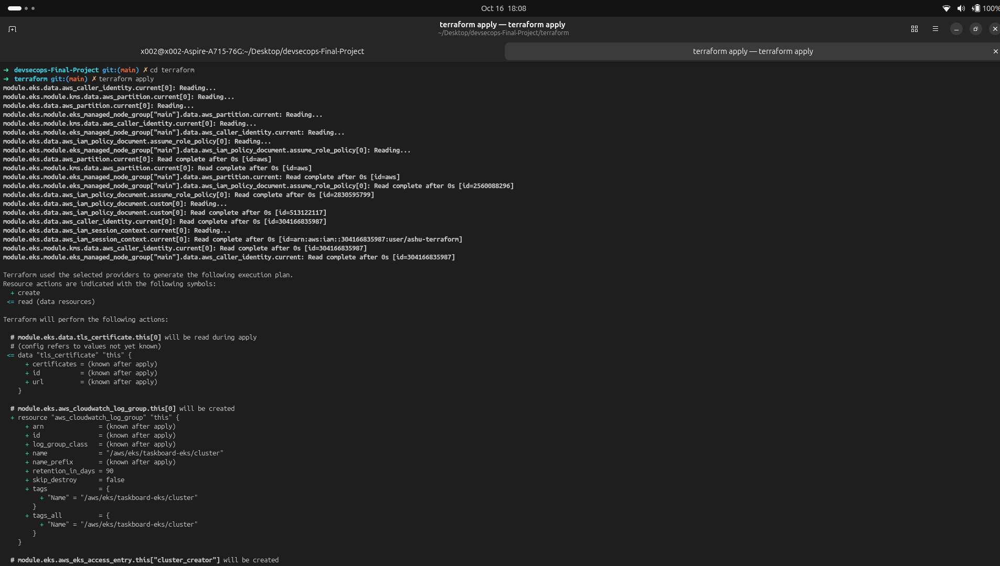
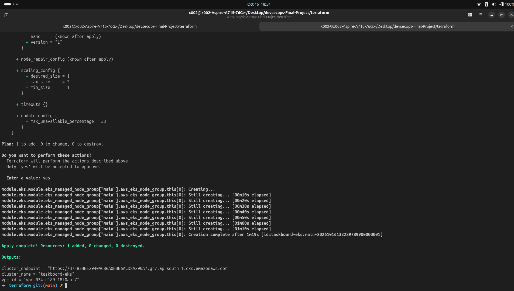
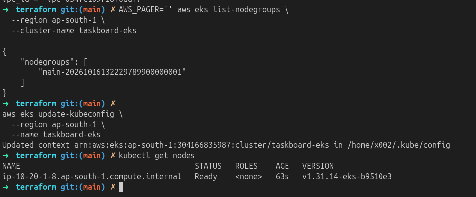
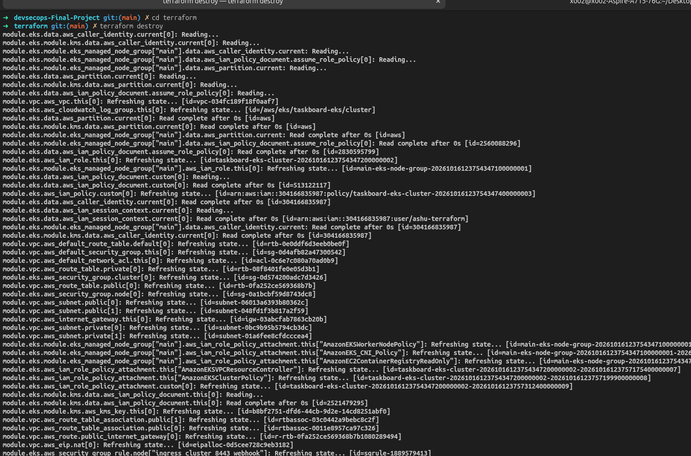

# Terraform and AWS Infrastructure

Terraform provisions the AWS foundation for the Kubernetes deployment. The configuration in [`terraform/main.tf`](../terraform/main.tf) uses the community VPC and EKS modules.

## Provisioned resources

- VPC with CIDR `10.20.0.0/16`
- Two public subnets and two private subnets across `ap-south-1a` and `ap-south-1b`
- A single NAT gateway for private subnet egress
- EKS cluster `taskboard-eks` on Kubernetes `1.31`
- Managed node group using `t3.micro`, with one desired node and capacity for two

The small node group is intended for a short classroom demonstration. Monitoring components may require more capacity in a production-sized cluster.

## Lifecycle

```bash
cd terraform
terraform init
terraform fmt -check -recursive
terraform validate
terraform plan
terraform apply
aws eks update-kubeconfig --region ap-south-1 --name taskboard-eks
kubectl get nodes
```

Review the plan before applying. AWS access is configured through the AWS CLI; credentials must never be placed in Terraform files or committed to Git.









Destroy the environment after the demonstration to stop ongoing AWS charges:

```bash
terraform destroy
```

