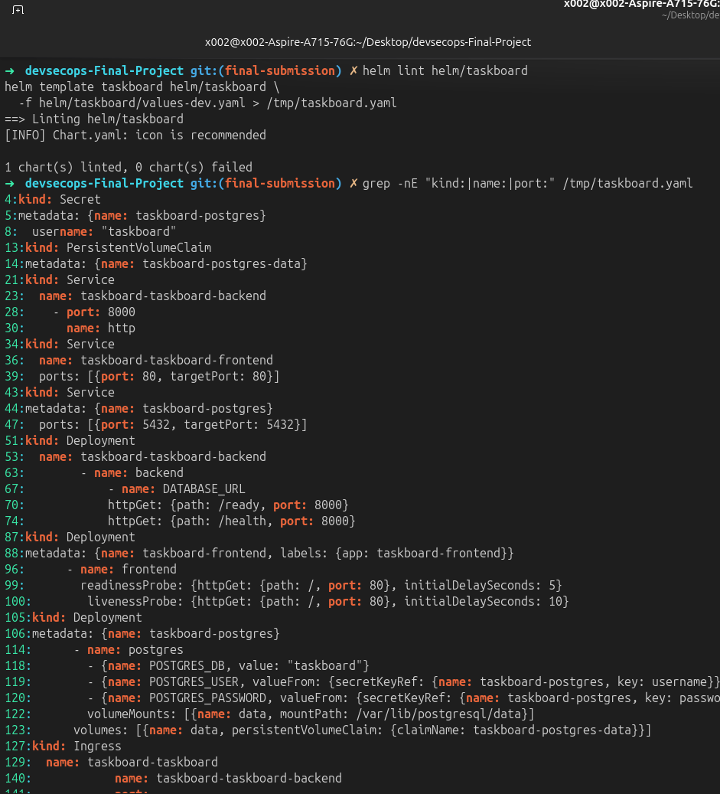
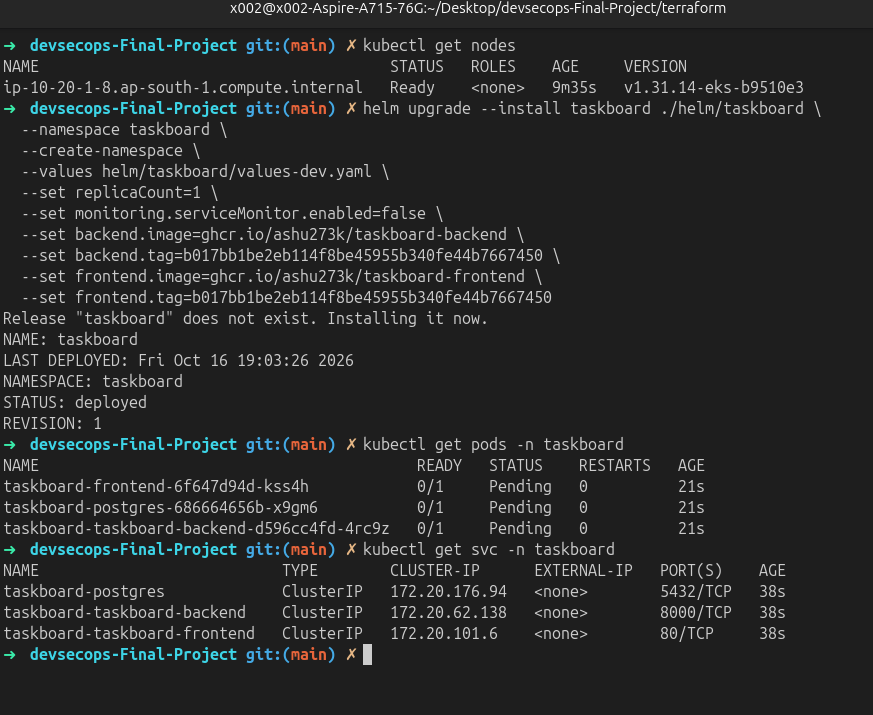

# Kubernetes and Helm

The supported deployment path is the Helm chart in [`helm/taskboard`](../helm/taskboard). It packages the frontend, backend, PostgreSQL, Services, optional Ingress, HPA, and monitoring resources into one release.

## Install or upgrade

Use the SHA produced by the CI workflow for both application images:

```bash
helm upgrade --install taskboard ./helm/taskboard \
  --namespace taskboard \
  --create-namespace \
  --values helm/taskboard/values-dev.yaml \
  --set replicaCount=1 \
  --set backend.image=ghcr.io/<owner>/taskboard-backend \
  --set backend.tag=<commit-sha> \
  --set frontend.image=ghcr.io/<owner>/taskboard-frontend \
  --set frontend.tag=<commit-sha>
```

The development values keep the deployment small. The base values enable two replicas, HPA, resource requests, and the ServiceMonitor. Choose values appropriate for the available node capacity.

## Traffic and workload resources

- The backend Service exposes port `8000` inside the cluster.
- The frontend Service exposes port `80` inside the cluster.
- When enabled, the Nginx Ingress Controller routes `/api` to the backend and `/` to the frontend for `taskboard.local`.
- The HPA targets 60% CPU and can scale from two to six replicas when metrics are available.

Enable Ingress only after an Nginx Ingress Controller is installed. An Ingress object by itself does not provide an external address.

## Verify the release

```bash
kubectl get pods -n taskboard
kubectl get svc -n taskboard
kubectl get ingress -n taskboard
helm list -n taskboard
```





## Common deployment failures

- `Pending`: inspect pod events and node CPU or memory capacity.
- `ImagePullBackOff`: make GHCR packages public or configure an image pull secret.
- No Ingress address: install and configure an Ingress Controller.
- PostgreSQL startup failure: inspect the database pod logs and verify the chart's database settings.