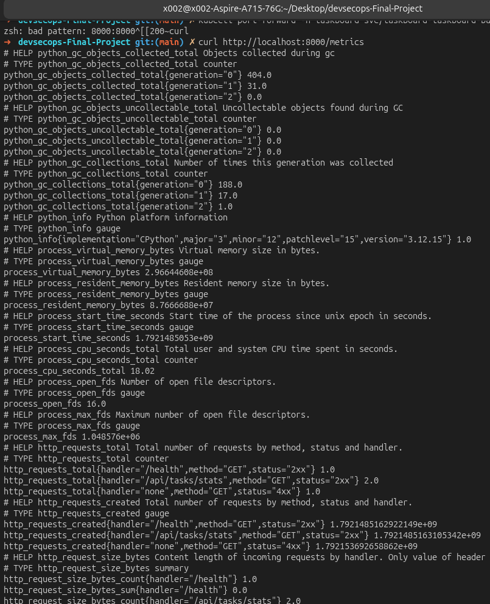
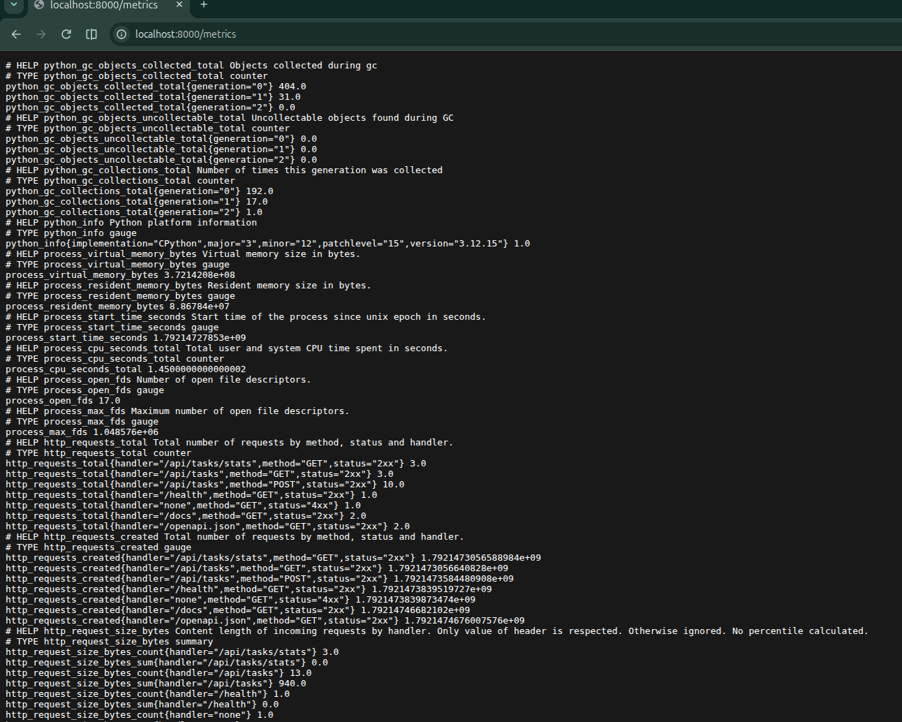
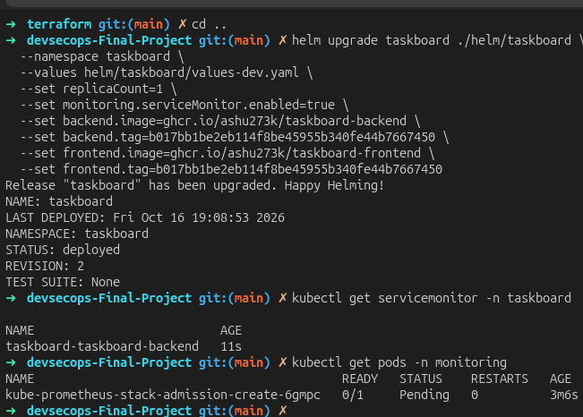
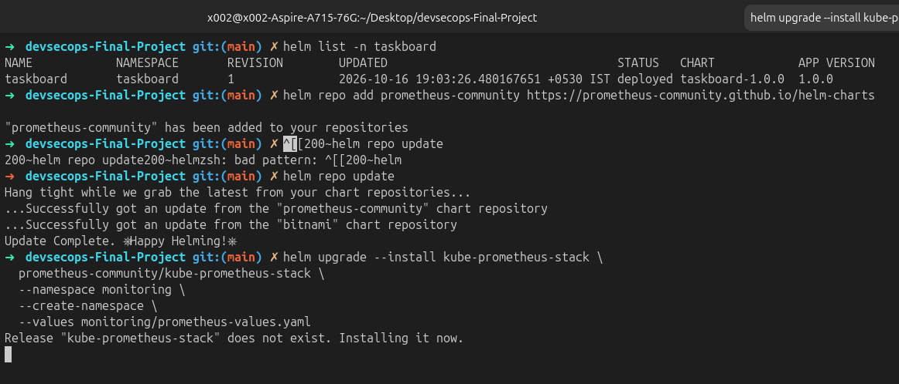

# Observability

The backend exposes Prometheus metrics through `prometheus-fastapi-instrumentator`:

```bash
kubectl port-forward -n taskboard svc/taskboard-taskboard-backend 8000:8000
curl http://localhost:8000/metrics
```

The endpoint includes request count, response latency, and status-code metrics in Prometheus text format.

## Prometheus and Grafana

Install `kube-prometheus-stack` using [`monitoring/prometheus-values.yaml`](../monitoring/prometheus-values.yaml). The values enable Grafana and allow Prometheus to select ServiceMonitors across namespaces:

```bash
helm repo add prometheus-community https://prometheus-community.github.io/helm-charts
helm repo update
helm upgrade --install kube-prometheus-stack \
  prometheus-community/kube-prometheus-stack \
  --namespace monitoring \
  --create-namespace \
  --values monitoring/prometheus-values.yaml
```

The TaskBoard chart creates a ServiceMonitor when `monitoring.serviceMonitor.enabled=true`. It selects the backend Service, scrapes `/metrics` on the `http` port, and uses a 15-second interval.

```bash
helm upgrade taskboard ./helm/taskboard \
  --namespace taskboard \
  --values helm/taskboard/values-dev.yaml \
  --set monitoring.serviceMonitor.enabled=true
kubectl get servicemonitor -n taskboard
kubectl get pods -n monitoring
```









## Diagnostic sequence

1. Confirm the backend responds to `/metrics`.
2. Confirm the ServiceMonitor exists in the `taskboard` namespace.
3. Confirm Prometheus has discovered the target and reports it as `UP`.
4. Confirm Grafana has a populated panel using the Prometheus data source.
5. If scraping fails, inspect Service labels, endpoint names, and Prometheus Operator logs.